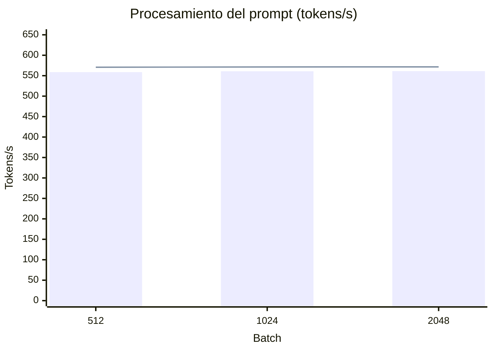
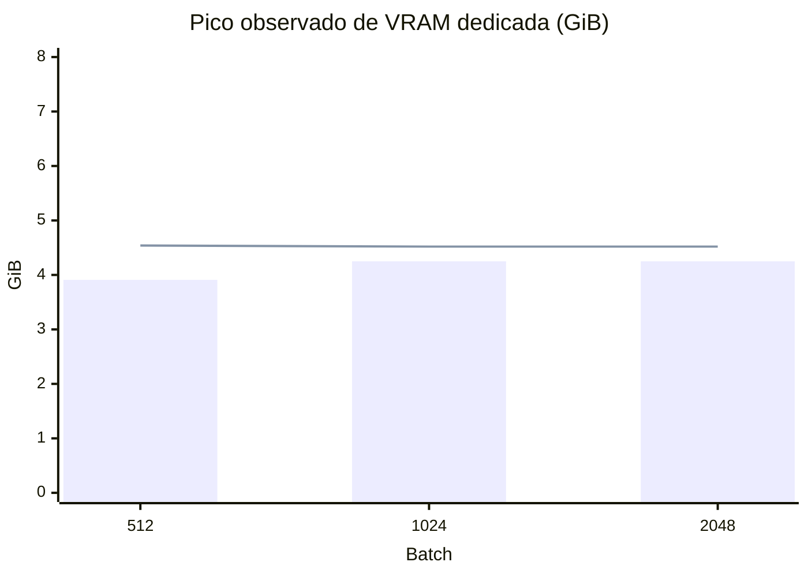

# Servidor de Agentes Locales

API local para ejecutar modelos GGUF con [llama.cpp](https://github.com/ggml-org/llama.cpp) y conectarlos a clientes compatibles con la API de OpenAI. FastAPI administra los agentes y las solicitudes; no necesitas Ollama.

Esta guía está pensada para empezar en Windows. Los nombres de las rutas y algunos pasos pueden variar en otros sistemas.

## Qué ofrece

- Agentes configurados mediante YAML y ejecución local de modelos GGUF, sin Ollama.
- Chat compatible con OpenAI, con respuestas normales o streaming.
- Modelo de embeddings independiente y búsqueda semántica opcional mediante MCP.
- Búsqueda opcional mediante SearXNG y skills locales que el modelo puede solicitar.
- Avisos al acercarse al límite de contexto y registro del consumo de la última inferencia.

Empieza por [Inicio rápido](#inicio-rápido); después puedes consultar [Embeddings](#embeddings-con-un-modelo-separado), [Búsqueda web](#búsqueda-web), [Skills locales](#skills-locales) y [Contexto y consumo](#contexto-y-consumo).

## Qué necesitas

- Windows 11 de 64 bits.
- Python 3.13 (versión utilizada en las pruebas; otras versiones no se han verificado).
- `llama-server` de llama.cpp y un modelo compatible en formato GGUF.
- Una GPU compatible con Vulkan es opcional; acelera la generación si tu compilación y tu equipo la admiten.
- Para búsquedas web: una instancia SearXNG accesible desde el equipo.

> Los modelos GGUF pueden ocupar varios GB. Comprueba que tienes espacio en disco y memoria suficientes para el modelo elegido.

## Inicio rápido

### 1. Descarga el proyecto

Abre PowerShell y ejecuta:

```powershell
git clone https://github.com/Game150/servidor-agente-local.git
cd servidor-agente-local
```

### 2. Coloca llama.cpp y el modelo

Descarga una compilación de [llama.cpp para Windows](https://github.com/ggml-org/llama.cpp/releases) que incluya `llama-server.exe`. Extrae la carpeta dentro de la carpeta del proyecto; su nombre debe empezar por `llama`, por ejemplo:

```text
servidor-agente-local/
├── llama-b12292-bin-win-vulkan-x64/
│   └── llama-server.exe
└── ...
```

También puedes guardar `llama-server.exe` en el `PATH` o indicar su ubicación exacta en `LLAMA_SERVER_PATH`, en el archivo `.env`.

Crea la carpeta `models` y coloca dentro el archivo `.gguf` que quieras usar:

```powershell
New-Item -ItemType Directory -Force .\models
```

El proyecto no incluye el modelo: debes conseguir y descargar por separado un GGUF compatible. El agente incluido está configurado para un archivo llamado `qwen2.5-coder-7b-instruct-q4_k_m.gguf`. Si el archivo descargado tiene otro nombre, cambia el campo `modelo` en `config/agentes/desarrollador.yaml` por el nombre del archivo sin `.gguf`.

### 3. Prepara la configuración

Crea tu archivo `.env` local:

```powershell
Copy-Item .env.example .env
```

Abre `.env` y revisa estos valores:

```env
MODELS_DIR=models
LLAMA_SERVER_PATH=
LLAMA_HOST=127.0.0.1
LLAMA_PORT=8080
API_KEY=
SEARXNG_URL=http://127.0.0.1:8888
```

- `MODELS_DIR`: carpeta con tus archivos `.gguf`. Acepta una ruta absoluta, por ejemplo `D:\Modelos`, además de `models`.
- `LLAMA_SERVER_PATH`: opcional. Déjalo vacío si el ejecutable está dentro de una carpeta `llama*` del proyecto o en el `PATH`.
- `LLAMA_HOST` y `LLAMA_PORT`: dirección interna de llama.cpp. Déjalos como están salvo que necesites cambiarla.
- `API_KEY`: opcional para uso local. Si la defines, todos los endpoints salvo `/` requieren el encabezado `Authorization: Bearer TU_CLAVE`. Usa una clave propia y no compartas ni subas `.env`.
- `SEARXNG_URL`: dirección base de tu instancia SearXNG, sin `/search`. El valor mostrado arriba es un **ejemplo** para una instancia en el mismo equipo; debes añadirlo o descomentarlo en `.env` y ajustarlo. Si no lo defines, el código usa `http://192.168.10.254:8888`, una dirección de red local que probablemente no corresponda a tu instalación.

El servidor y llama.cpp escuchan en `127.0.0.1` por defecto; así solo aceptan conexiones locales.
Reinicia la API después de cambiar `.env`; se lee al iniciar el proceso. Las variables de entorno ya definidas en el sistema tienen prioridad sobre `.env`.

### 4. Instala las dependencias de Python

Desde la carpeta del proyecto:

```powershell
python -m venv .venv
.\.venv\Scripts\python.exe -m pip install -r requirements.txt
```

No hace falta activar el entorno virtual.

### 5. Arranca el servidor

Haz doble clic en `iniciar-servidor.bat`, o ejecuta desde PowerShell:

```powershell
.\.venv\Scripts\python.exe -m uvicorn app.main:app --host 127.0.0.1 --port 8000
```

Deja abierta la ventana mientras uses la API. Para detenerla, pulsa `Ctrl+C`.

Comprueba que está activo:

```powershell
Invoke-RestMethod http://127.0.0.1:8000/
```

La documentación interactiva de FastAPI está en <http://127.0.0.1:8000/docs>.

### 6. Envía un mensaje de prueba

El identificador del agente incluido es `desarrollador`. La primera conversación inicia el agente y carga su modelo automáticamente; no es necesario iniciar el motor por separado.

```powershell
$headers = @{}
# Si configuraste API_KEY en .env, descomenta la siguiente línea y reemplaza el valor:
# $headers.Authorization = "Bearer TU_CLAVE"

$body = @{
  model = "desarrollador"
  messages = @(@{ role = "user"; content = "Responde únicamente: API lista" })
  stream = $false
} | ConvertTo-Json -Depth 10

Invoke-RestMethod `
  -Method Post `
  -Uri http://127.0.0.1:8000/v1/chat/completions `
  -Headers $headers `
  -ContentType "application/json" `
  -Body $body
```

La primera respuesta puede tardar mientras se carga el modelo. Las siguientes reutilizan el proceso activo.

## Conecta una aplicación cliente

La API ofrece los endpoints `GET /v1/models`, `POST /v1/chat/completions` y, si configuras un modelo dedicado, `POST /v1/embeddings`. No implementa todas las rutas ni todas las funciones de cada proveedor compatible con OpenAI.

### Embeddings con un modelo separado

Un modelo de embeddings convierte texto en vectores numéricos. Estos permiten comparar la similitud entre textos; por ejemplo, una herramienta puede buscar fragmentos de código relacionados con una consulta. **No generan respuestas de chat ni añaden contexto automáticamente**: un cliente debe solicitar los vectores y decidir cómo utilizarlos.

#### Configuración

Descarga por separado un modelo GGUF compatible con embeddings y colócalo en `MODELS_DIR`. Configura su nombre de archivo **sin `.gguf`** en el `.env` del servidor. Este es un ejemplo: cambia el nombre para que coincida exactamente con tu archivo.

```dotenv
EMBEDDINGS_MODEL=nomic-embed-text-v1.5
EMBEDDINGS_HOST=127.0.0.1
EMBEDDINGS_PORT=8081
EMBEDDINGS_CTX_SIZE=2048
EMBEDDINGS_GPU_LAYERS=0
```

| Variable | Valor predeterminado | Función |
|---|---|---|
| `EMBEDDINGS_MODEL` | Vacío | Nombre del GGUF sin extensión. Vacío deja el endpoint sin modelo disponible. |
| `EMBEDDINGS_HOST` | El valor de `LLAMA_HOST` | Dirección interna del proceso de embeddings. Normalmente `127.0.0.1`. |
| `EMBEDDINGS_PORT` | `8081` | Puerto interno del proceso de embeddings; debe estar libre y ser distinto del puerto del motor de chat. |
| `EMBEDDINGS_CTX_SIZE` | `2048` | Tamaño de contexto del motor de embeddings, en tokens. Debe ser mayor que cero. También se usa como tamaño de batch y microbatch. |
| `EMBEDDINGS_GPU_LAYERS` | `0` | Capas que se intentan cargar en GPU. `0` usa CPU; un valor mayor puede usar VRAM y acelerar el procesamiento. |

Esta configuración es independiente de los YAML de agentes. Por ahora no hay ajustes propios de hilos, paralelismo o argumentos adicionales para embeddings; el motor usa un slot. Un contexto mayor puede requerir más memoria, y el límite efectivo también depende del modelo y de llama.cpp. Los resultados dependen del GGUF, su configuración de pooling y la versión de llama.cpp.

Reinicia la API después de cambiar `.env`. Si también usas el MCP, reinicia su proceso en el cliente para que vuelva a leer la configuración. Las variables de entorno ya definidas tienen prioridad sobre `.env`.

#### Carga y uso de memoria

La API no carga el modelo de embeddings al arrancar. La primera petición válida a `POST /v1/embeddings` inicia otro proceso `llama-server` y espera a que cargue el GGUF. Las siguientes peticiones reutilizan ese proceso; **no se descarga tras cada búsqueda**. El modelo de chat puede seguir cargado y atendiendo solicitudes en su propio proceso.

Ambos modelos pueden consumir memoria al mismo tiempo. Por defecto, embeddings usa CPU para no competir por la VRAM del chat. Al detener la API se detienen ambos procesos; `POST /engine/stop` solo detiene el motor de chat, no el de embeddings. El estado de `/engine/status` también corresponde al motor de chat. El log de embeddings está en `logs/llama-server-embeddings.log`, o en `LOG_DIR` si cambiaste esa carpeta.

#### Probar el endpoint

Mantén la API iniciada y ejecuta en PowerShell, sustituyendo el nombre por el de `EMBEDDINGS_MODEL`:

```powershell
$headers = @{}
# Si configuraste API_KEY, descomenta y reemplaza el valor:
# $headers.Authorization = "Bearer TU_CLAVE"

$body = @{
  model = "nomic-embed-text-v1.5"
  input = "Texto de ejemplo"
} | ConvertTo-Json

$resultado = Invoke-RestMethod `
  -Method Post `
  -Uri http://127.0.0.1:8000/v1/embeddings `
  -Headers $headers `
  -ContentType "application/json" `
  -Body $body

$resultado.data[0].embedding
```

La respuesta contiene el vector en `data[0].embedding`; su dimensión depende del modelo. La primera petición puede tardar mientras se carga. También puedes enviar varios textos en `input`:

```json
{
  "model": "nomic-embed-text-v1.5",
  "input": ["primer texto", "segundo texto"]
}
```

El campo `model` debe coincidir con `EMBEDDINGS_MODEL`. La API reenvía `input` y los demás campos al llama-server de embeddings, sustituyendo `model` por `local` internamente; las opciones admitidas y el formato de respuesta dependen de esa versión de llama.cpp. El identificador configurado también aparece en `GET /v1/models`. La ruta usa la misma autenticación `API_KEY` que el chat.

Si falta `input`, responde `400`; si el modelo solicitado no coincide, `404`; y si no está configurado o no puede arrancar, `503`. Los errores del motor también se devuelven al cliente. Comprueba el log de embeddings si el GGUF no carga o no admite embeddings.

### Búsqueda semántica local para Cline

El MCP opcional permite que Cline busque código por significado sin enviarle todo el proyecto. Es un servidor MCP local por **stdio**: también puede configurarse en otras extensiones o IDEs que admitan ese transporte y permitan al agente llamar herramientas MCP. La configuración concreta depende del cliente.

La indexación se inicia **solo cuando se solicita** y el índice SQLite queda en `logs/indices/`, o en `LOG_DIR/indices/` si cambiaste la carpeta; no requiere Qdrant. Necesitas Git, un proyecto Git, el modelo de embeddings configurado y la API de este proyecto en ejecución. La primera indexación puede tardar: genera embeddings para cada fragmento.

Instala el SDK MCP en el entorno virtual del servidor:

```powershell
.\.venv\Scripts\python.exe -m pip install -r requirements-mcp.txt
```

En Cline abre **MCP Servers > Configure > Configure MCP Servers** y añade una entrada a `mcpServers`. Sustituye ambas rutas por rutas absolutas de tu equipo; en JSON las barras invertidas se escriben dobles:

```json
{
  "mcpServers": {
    "busqueda-codigo-local": {
      "command": "C:\\ruta\\servidor-agente-local\\.venv\\Scripts\\python.exe",
      "args": ["C:\\ruta\\servidor-agente-local\\mcp_busqueda.py"],
      "env": {
        "MCP_WORKSPACE": "C:\\ruta\\proyecto-a-indexar"
      },
      "timeout": 600,
      "autoApprove": []
    }
  }
}
```

El MCP toma `EMBEDDINGS_MODEL` y `API_KEY` del `.env` de este servidor. Por defecto llama a `http://127.0.0.1:8000`; si la API escucha en otra dirección, añade `MCP_API_URL` a `env` y reinicia el MCP. Para modelos que requieren prefijos de tarea, como Nomic Embed, añade `"MCP_DOCUMENT_PREFIX": "search_document:"` y `"MCP_QUERY_PREFIX": "search_query:"` a `env` antes de indexar. Usa los prefijos indicados por el modelo que elegiste.

Si el índice no existe, pide explícitamente a Cline que ejecute `indexar_proyecto`; luego usa `buscar_codigo` con una consulta en lenguaje natural. Para cambios posteriores, solicita actualizar el índice. Por ejemplo: «Indexa el proyecto y busca dónde se valida el inicio de sesión».

Al indexar, el MCP divide el texto en fragmentos de hasta 1000 caracteres y solicita un vector para cada uno. Al buscar, convierte la consulta en otro vector y compara su similitud con los guardados. También busca términos en el texto y las rutas de archivo mediante SQLite FTS5 y combina ambos rankings con Reciprocal Rank Fusion (RRF), sin sumar sus puntuaciones. Devuelve por defecto tres fragmentos, con ruta, líneas y texto; `limite` acepta de uno a cinco resultados. La propiedad `similitud` sigue siendo la puntuación vectorial; el orden final usa RRF. La consulta admite hasta 1000 caracteres y SQLite debe incluir FTS5. Al abrir por primera vez un índice previo, el índice textual se crea desde los fragmentos existentes, sin recalcular ni borrar sus vectores. El texto y las líneas corresponden a la última indexación, no necesariamente al estado actual del archivo.

Para recuperar contexto alrededor de un resultado, usa la herramienta MCP `leer_lineas` con `ruta` (la ruta relativa devuelta por la búsqueda), `linea` (número inicial, desde 1) y `margen` (líneas a cada lado; predeterminado 5, máximo 30). Por ejemplo: `leer_lineas(ruta="app/main.py", linea=120, margen=5)`. Solo permite leer archivos del índice que sigan dentro del workspace; rechaza rutas fuera del proyecto y archivos no indexados. Devuelve la ruta, el rango, el contenido y si se truncó. Limita la salida a 61 líneas y 8.000 caracteres.

La indexación posterior reutiliza los vectores de archivos sin cambios y elimina los archivos ya no presentes. No hay observador automático: vuelve a indexar cuando cambie el código. Si cambia el nombre del modelo o los prefijos, vuelve a indexar; si sustituyes el GGUF por otro con el mismo nombre, solicita `indexar_proyecto` con `reconstruir=true`. Si falla la generación de embeddings durante una actualización, se conserva el índice anterior.

El MCP indexa archivos UTF-8 de extensiones habituales que Git lista dentro de `MCP_WORKSPACE`: respeta los archivos ignorados **no rastreados**, pero Git incluye archivos ya rastreados aunque coincidan con `.gitignore`. Excluye archivos `.env`, enlaces simbólicos, binarios y archivos de más de 256 KiB. No detecta todos los secretos: revisa qué contiene el proyecto antes de indexar. El índice guarda texto y vectores localmente, y los fragmentos se envían a la API configurada; no uses una API remota si no quieres enviarle el código. Cada MCP apunta a un solo proyecto; cambia `MCP_WORKSPACE` y reinicia el MCP para usar otro. El índice es una ayuda para localizar código, no garantiza que Cline lo consulte ni que encuentre siempre el fragmento correcto.
El registro `LOG_DIR/mcp-busqueda.log` conserva metadatos de operación (tipo de operación, cantidad de resultados y duración), no consultas, fragmentos, rutas ni la ruta local del workspace.

### Búsqueda semántica interna de la API

La API puede ofrecer `indexar_proyecto` y `buscar_codigo` como herramientas internas, sin configurar un servidor MCP ni vincular un cliente concreto. Configura en `.env` `CODE_SEARCH_ENABLED=true`, `CODE_SEARCH_WORKSPACE` como ruta absoluta del proyecto y `EMBEDDINGS_MODEL` con el nombre de un GGUF disponible. Reinicia la API después de cambiar esas variables.

Al iniciar, la API registra si la búsqueda está habilitada y, si lo está, el workspace configurado, el directorio del índice y el modelo de embeddings. Al empezar una indexación vuelve a registrar el workspace y la ruta del índice; así puedes confirmar en el log qué proyecto está usando.

Pide al agente que **indexe o actualice explícitamente el proyecto**. La herramienta `indexar_proyecto` inicia el motor local de embeddings si hace falta y crea o actualiza el índice en `LOG_DIR/indices/`; luego puedes pedir búsquedas semánticas con `buscar_codigo`. No se indexa automáticamente al buscar. Si una búsqueda indica que falta el índice o está desactualizado, el agente debe explicarlo y pedir autorización antes de indexar. La indexación usa los archivos Git del workspace y las mismas exclusiones descritas arriba; `.env` se excluye.

Los prefijos opcionales se configuran con `CODE_SEARCH_DOCUMENT_PREFIX` y `CODE_SEARCH_QUERY_PREFIX` y deben coincidir con los que requiere el modelo. Para una indexación incremental normal no hace falta reconstruir. Solicita `reconstruir=true` solo si necesitas regenerar todos los vectores, por ejemplo tras sustituir el GGUF conservando el mismo nombre.

Si el cliente ofrece `buscar_codigo` o un nombre MCP terminado en `__buscar_codigo`, se prioriza la herramienta del cliente y no se ofrece la búsqueda ni la indexación internas, evitando duplicados. De lo contrario el modelo puede solicitar las herramientas internas; esto no garantiza que decida usar una. La búsqueda e indexación internas usan únicamente el workspace configurado en la API, que puede ser distinto del proyecto abierto en el cliente. Los fragmentos son datos no confiables y pueden estar desactualizados. Su uso queda registrado en el log de la API, sin consultas ni contenido.

### Clientes de chat

Usa estos valores en clientes que acepten un proveedor OpenAI-compatible:

| Campo | Valor |
|---|---|
| URL base | `http://127.0.0.1:8000/v1` |
| Modelo | `desarrollador` |
| API key | La misma clave de `API_KEY`, si configuraste una |

Si un cliente pide la URL completa de completions en lugar de la URL base, usa `http://127.0.0.1:8000/v1/chat/completions`.

### Continue

En el archivo `config.yaml` de Continue, puedes configurar un modelo así:

```yaml
name: Servidor Agente Local
version: 1.0.0
schema: v1
models:
  - name: Agente Desarrollador local
    provider: openai
    model: desarrollador
    apiBase: http://127.0.0.1:8000/v1
    apiKey: local
    roles:
      - chat
    defaultCompletionOptions:
      contextLength: 32768
      maxTokens: 4096
```

Si definiste `API_KEY`, cambia `apiKey: local` por la misma clave. Si la dejaste vacía, puedes quitar la línea `apiKey`.
El ejemplo corresponde al agente `desarrollador`: si cambias su contexto o su límite de salida, ajusta también estos valores en Continue.

Para que Continue liste todos tus agentes sin escribirlos uno por uno, usa `model: AUTODETECT`. Continue consulta `/v1/models`, que incluye cada agente de `config/agentes/` y, si está configurado, el identificador de embeddings:

```yaml
models:
  - name: Agentes locales
    provider: openai
    model: AUTODETECT
    apiBase: http://127.0.0.1:8000/v1
    apiKey: local
    roles:
      - chat
```

Al cambiar de agente en Continue, el servidor cambia de modelo y puede tardar unos segundos. El `contextLength` de Continue es único para todos; usa el valor del agente con menos contexto.

Empieza probando el chat normal. El uso de herramientas desde modos agente depende también de la versión y configuración de Continue.

### Extensiones de Chrome

La extensión debe permitir configurar un endpoint OpenAI-compatible y conectarse a servicios locales. Usa los valores de la tabla anterior; si solicita la URL completa, usa la ruta `/v1/chat/completions`. Concede a la extensión el permiso de acceder al servidor local si Chrome lo solicita.

Chrome por sí solo no envía mensajes a esta API: necesitas una extensión que admita endpoints personalizados. Otras extensiones pueden tener requisitos distintos; consulta su documentación.

## Búsqueda web

El agente puede decidir si necesita buscar información externa usando la herramienta `buscar_en_web`. El flujo funciona con solicitudes normales y con streaming:

1. El modelo solicita una búsqueda.
2. El servidor consulta SearXNG.
3. Los resultados se agregan a la conversación y el modelo prepara la respuesta.

Para probarlo desde tu cliente, intenta:

> Busca en la web la versión estable más reciente de Python. Usa fuentes oficiales e incluye la versión, la fecha de publicación y los enlaces. No respondas de memoria.

La búsqueda requiere que `SEARXNG_URL` apunte a una instancia activa y accesible. Además, la versión de llama.cpp y la plantilla de chat incluida en el modelo deben admitir tool calling. La compatibilidad puede variar entre modelos y clientes; si el modelo no invoca la herramienta, revisa sus registros y configuración.

Si administras SearXNG, verifica que `json` esté habilitado en `search.formats` junto a los formatos que necesites. Consulta la [configuración de búsqueda de SearXNG](https://docs.searxng.org/admin/settings/settings_search.html). Puedes comprobar tu instancia desde PowerShell, reemplazando la dirección por la tuya:

```powershell
Invoke-RestMethod -Uri "http://127.0.0.1:8888/search?q=python&format=json"
```

La API no instala ni inicia SearXNG. Sin una instancia accesible, el chat normal puede funcionar, pero las búsquedas que el modelo solicite fallarán.

La búsqueda está activada por defecto. Para desactivarla, configura `WEB_SEARCH_ENABLED=false` en `.env` y reinicia la API: el servidor deja de ofrecer su herramienta `buscar_en_web`. Esto no desactiva herramientas de búsqueda propias del cliente.

La consola registra el inicio, la finalización o el fallo de cada búsqueda, sin registrar la consulta ni los resultados.

El servidor incorpora como máximo tres resultados y limita su tamaño. Los trata como información externa no confiable, no como instrucciones. Las búsquedas y cargas de skills comparten un máximo de tres llamadas y tres iteraciones de herramientas por solicitud.

En streaming, si ocurre un error después de iniciar la respuesta, el estado HTTP ya puede ser `200`; el error se envía dentro del flujo SSE antes de `[DONE]`. Por eso, un `200 OK` en la consola no demuestra por sí solo que la búsqueda haya tenido éxito.

## Skills locales

Las skills son instrucciones reutilizables para tareas específicas; no necesitan npm. El servidor busca carpetas con un archivo `SKILL.md` dentro de `skills/`. Incluye `skills/explicar-codigo/SKILL.md` como ejemplo. Puedes cambiar la carpeta raíz mediante `SKILLS_DIR` en `.env`.

Para crear una skill, añade una carpeta cuyo nombre coincida con `name`:

```text
skills/
└── revisar-codigo/
    └── SKILL.md
```

```markdown
---
name: revisar-codigo
description: Revisa código y busca errores cuando el usuario pide una revisión.
---

# Revisar código

Comprueba el comportamiento y explica los problemas encontrados con evidencia.
```

El nombre debe usar letras minúsculas, números o guiones, sin guiones consecutivos ni al principio o final. La descripción es obligatoria. El servidor lee la configuración en cada solicitud y muestra al modelo las skills disponibles y las herramientas internas habilitadas; las herramientas aportadas por el cliente se conservan según sus propios nombres y esquemas. El modelo debe usar solo herramientas efectivamente listadas y no asumir acceso a archivos, terminal o MCP si no se ofrece. Una skill aporta instrucciones, pero no concede herramientas ni permisos. Si una skill coincide claramente con la tarea principal, debe cargarla con `cargar_skill` antes de usar otras herramientas; si ninguna coincide, puede continuar sin cargar una. También puedes pedir una skill por nombre, aunque la selección automática depende del modelo y de su soporte para tool calling.

Para no depender del modelo, el frontmatter acepta `triggers`, una lista opcional de prefijos de palabra (sin importar mayúsculas ni acentos), por ejemplo `triggers: [revis, "code review"]`. Si la petición del usuario (en Cline, el contenido de `<task>`) coincide con los triggers de una única skill, el servidor carga sus instrucciones directamente y lo registra como «seleccion automatica». Con empate o sin coincidencias, decide el modelo.

En cada solicitud, el servidor vuelve a elegir la skill usando el último mensaje del usuario presente en el historial. Ignora mensajes con rol `tool`, bloques estructurados o etiquetados como `tool_result`, y bloques de contexto del cliente como `<environment_details>` y `<hook_context>`; un nuevo mensaje del usuario vuelve a determinar la selección. Para conservar una selección explícita mediante el campo `skills`, el cliente debe enviarla en cada solicitud.

El frontmatter también acepta `agentes`, una lista opcional de identificadores de agente (el `id` del YAML), por ejemplo `agentes: [desarrollador]`. Si se define, solo esos agentes ven y cargan la skill; sin el campo, la ven todos.

Para seleccionar una skill de forma explícita desde una integración propia, agrega el campo opcional `skills` al JSON de `POST /v1/chat/completions`:

```json
{
  "model": "desarrollador",
  "messages": [{"role": "user", "content": "Revisa este código"}],
  "skills": ["revisar-codigo"]
}
```

Este campo es una extensión propia de la API, no parte del formato estándar OpenAI; los clientes que no permitan campos personalizados pueden usar la selección automática. Se admiten hasta tres nombres explícitos. Si falta una skill seleccionada o un `SKILL.md` es inválido, la solicitud devuelve un error.

Solo se carga el contenido de `SKILL.md`; no se ejecutan scripts ni se leen automáticamente archivos de `scripts/`, `references/` o `assets/`. Esto es un subconjunto del formato [Agent Skills](https://agentskills.io/specification), no una implementación completa. Instala solo skills de confianza: sus instrucciones pasan al modelo.

Al cargar instrucciones de una skill, la consola del servidor muestra `Skill cargada: nombre`, indicando si la solicitó el modelo o se seleccionó explícitamente. No se registra el contenido de la skill ni la conversación. La presencia de una skill en el catálogo, por sí sola, no genera este mensaje.

Al iniciar, la consola también muestra los nombres en `Skills disponibles`; si no hay ninguna, indica `(ninguna)`. Si agregas o quitas skills, el catálogo se vuelve a registrar en la siguiente solicitud, sin repetirlo cuando no cambia. Si el catálogo es inválido al arrancar, aparece una advertencia; las solicitudes informan el error hasta corregirlo.

Si el modelo solicita un nombre válido que no está en el catálogo, el servidor registra una advertencia y le devuelve el error y los nombres disponibles para que pueda corregirse. Las llamadas malformadas siguen devolviendo un error. La recuperación depende del modelo y de los límites de llamadas a herramientas.

### Dónde conseguir skills

- [Agent Skills](https://agentskills.io/home): explicación del formato y [especificación](https://agentskills.io/specification) para crear o revisar una skill.
- [Anthropic Skills](https://github.com/anthropics/skills/tree/main/skills): colección de ejemplos organizados en carpetas con `SKILL.md`. Están pensados para Claude y algunas skills necesitan otras funciones que este servidor no tiene.
- [OpenAI Plugins](https://github.com/openai/plugins): ejemplos de plugins de Codex, algunos con carpetas de skills. Están diseñados para Codex y pueden depender de sus herramientas o integraciones.
- [skills.sh](https://skills.sh/): directorio para descubrir skills de distintos autores. Comprueba el repositorio de origen: su presencia en el directorio no garantiza seguridad ni compatibilidad.

Son fuentes para **descubrir y revisar**, no catálogos de skills garantizadas para este servidor. Los instaladores o comandos de otros agentes no instalan automáticamente skills en este proyecto; no necesitas npm para usarlas aquí.

### Cómo instalar una skill encontrada

1. Abre su repositorio de origen y revisa `SKILL.md`, la licencia y los requisitos. Usa solo contenido de confianza: las instrucciones influyen en las respuestas del modelo.
2. Descarga el repositorio o la carpeta de la skill y copia esa carpeta a `skills/` dentro de este proyecto. Por ejemplo, `skills/mi-skill/SKILL.md`, **sin una carpeta extra entre `skills/` y `mi-skill/`**.
3. Comprueba que `name` coincida exactamente con `mi-skill`, que haya `description` y texto de instrucciones, y que el archivo esté codificado en UTF-8. El servidor admite hasta 50 skills y cada `SKILL.md` puede ocupar hasta 32.000 bytes. El nombre tiene un máximo de 64 caracteres y la descripción, de 1.024.
4. Pide una tarea relacionada desde tu cliente y observa la consola. La carga automática depende de la decisión del modelo; si quieres probarla, menciona su nombre. Un log `Skill cargada` confirma que se incorporaron sus instrucciones, no que la respuesta sea correcta.

Las skills se vuelven a leer en cada solicitud, por lo que copiar o editar una skill no requiere reiniciar la API. Sin embargo, cambiar `SKILLS_DIR` en `.env` sí requiere reiniciarla. Algunas skills externas indican que el agente lea archivos adicionales, use herramientas específicas o ejecute código: esas capacidades no las aporta este servidor, así que la skill puede requerir adaptación o no funcionar como espera su autor. Revisa también su licencia antes de copiarla o redistribuirla.

Git ignora las skills locales agregadas dentro de `skills/`; el archivo de ejemplo `skills/explicar-codigo/SKILL.md` sí forma parte del proyecto. Las reglas de `.gitignore` no dejan de rastrear archivos que ya estén versionados.

## Contexto y consumo

El contexto es el espacio disponible para la entrada y la generación del modelo. Los mensajes, el archivo adjunto que el cliente envíe, las instrucciones del agente y los resultados de herramientas pueden ocupar parte de ese espacio. Los tokens de salida pueden incluir razonamiento, no solo el texto visible.

`reasoning_budget_tokens` limita cada bloque de razonamiento cuando la plantilla del modelo expone sus marcadores; no limita toda la salida, que sigue regida por `max_tokens`. `forzar_parametros` permite fijar selectivamente un parámetro sin impedir que el cliente ajuste el resto; `forzar: true` sigue fijándolos todos. Los agentes Qwen3.5 usan 1024 (9B) y 2048 (4B Pro); Gemma 4 E4B usa 2048 para conservar margen en tareas con documentos e imágenes. El agente Qwen2.5-Coder no fija este parámetro porque su plantilla no usa el bloque de razonamiento compatible. Estos límites son topes por bloque, pueden recortar razonamiento útil y no evitan necesariamente que el cliente compacte la conversación.

### Avisos en la respuesta

Al finalizar una respuesta de texto, la API puede añadir un aviso cuando el consumo informado por llama.cpp alcanza el **80 %** del contexto por slot, o un aviso más urgente desde el **95 %**. Funciona con y sin streaming. Por ejemplo:

> ⚠️ Contexto cerca del límite (aproximadamente 80 %). Considera resumir la conversación o iniciar un chat nuevo.

El cálculo usa `ctx_size / parallel` como referencia y suma entrada y generación de la inferencia final. Es aproximado: la configuración efectiva puede diferir si se alteran argumentos del motor. No se añade a respuestas JSON estructuradas, a llamadas de herramientas ni cuando faltan los datos necesarios. Tampoco garantiza avisar si el motor rechaza una solicitud demasiado grande antes de generar la respuesta.

### Cómo leer el log

Al terminar la respuesta, la consola puede mostrar una línea como esta, sin incluir la conversación:

```text
INFO:     Consumo de inferencia final: entrada=700 salida=100 total=800 contexto_por_slot=16384 ocupacion=4.9% motivo=stop prompt_tokens_s=543.66 generacion_tokens_s=61.78 cache_tokens=200 prompt_nuevos=500
```

- `entrada` incluye los tokens del prompt; `salida`, los generados por el motor.
- `cache_tokens` y `prompt_nuevos` son, respectivamente, los tokens reutilizados de la caché y los procesados en la última inferencia, si llama.cpp informa ambos datos. No incluyen el contenido de la solicitud.
- `total` es el consumo informado para la última inferencia. Si hubo llamadas a herramientas, no suma por separado todas las inferencias intermedias.
- `contexto_por_slot` y `ocupacion` sirven como referencia aproximada.
- `prompt_tokens_s` y `generacion_tokens_s` son las velocidades informadas por llama.cpp para procesar la entrada y generar la salida, respectivamente. Son de la última inferencia, no un promedio de toda la solicitud; la caché y el tamaño del contexto pueden afectar las comparaciones.
- `motivo=stop` indica una finalización normal; `motivo=length` señala que la generación terminó por un límite y puede explicar una respuesta cortada, aunque no demuestra que se haya llenado el contexto.
- Si llama.cpp no proporciona un dato, aparece `no disponible`. Los errores o cancelaciones pueden impedir que llegue la línea final.

Si una respuesta queda cortada, consulta el motivo y prueba pedir una respuesta más corta o por partes. También puedes aumentar el límite de salida del cliente —por ejemplo, `maxTokens` en Continue— si hay espacio suficiente; el agente usa `max_tokens: 2048` por defecto y el cliente puede sobrescribirlo.

## Configura otro agente o modelo

Los agentes son archivos YAML dentro de `config/agentes/`. El campo `id` es el nombre que envía el cliente como `model`; el campo `modelo` debe coincidir con el nombre de un archivo `.gguf` dentro de `MODELS_DIR`, sin la extensión.

La [plantilla completa de agente](./config/agentes/ejemplo.yaml.example) muestra
los campos opcionales, sus valores y los ajustes del motor. No termina en `.yaml`
ni `.yml`, así que no se carga como agente. Copiala a un archivo `.yaml` nuevo
y reemplaza el ID, el modelo y las opciones según el GGUF y el uso previsto.

Perfiles de modelos recientes disponibles:

| ID del agente | Modelo | Contexto configurado |
|---|---|---:|
| `desarrollador-pro` | Qwen3.5 4B | 131072 |
| `desarrollador-qwen3.5-9b` | Qwen3.5 9B | 16384 |
| `trabajo-gemma-4-e4b` | Gemma 4 E4B | 32768 |

Qwen3.5 admite hasta 262144 tokens y Gemma 4 E4B hasta 131072; los contextos
menores de estos perfiles son límites iniciales para contener el uso de memoria,
no límites nativos de los modelos. El perfil 9B usa un contexto y batches más
moderados para la RX 6600 XT de 8 GiB; su consumo y rendimiento reales no se han
medido en este perfil. Los YAML activos usan `gpu_layers: "auto"` y
`--fit-target 1024` para que llama.cpp ajuste el offload y reserve 1 GiB por
dispositivo; las capas que no quepan en VRAM pueden ejecutarse en CPU. Para
tareas de programación, el sampler Qwen sigue los valores recomendados por
Qwen3.5: `temperature: 0.6`, `top_p: 0.95`,
`top_k: 20`, `min_p: 0.0`, `presence_penalty: 0.0` y `repeat_penalty: 1.0`.
Gemma usa sus valores recomendados: temperatura 1.0, `top_p: 0.95` y
`top_k: 64`.

Ejemplo mínimo:

```yaml
id: desarrollador
nombre: Agente Desarrollador
descripcion: Asistente de desarrollo.

modelo: qwen2.5-coder-7b-instruct-q4_k_m

# Opcional: perfil compartido "desarrollo" o "trabajo".
perfil_prompt: desarrollo

# Opcional: instrucciones adicionales solo para este agente.
system_prompt: |
  Añade aquí únicamente instrucciones propias de este agente.

parametros:
  temperature: 0.3
  top_p: 0.9
  max_tokens: 4096
  forzar: false

motor:
  ctx_size: 32768
  gpu_layers: 99
  parallel: 1
```

Puedes cambiar el `id`, las instrucciones, los parámetros y el nombre del GGUF para crear otros agentes.
Las reglas comunes y los perfiles `desarrollo` y `trabajo` se definen en
`app/servicios/prompts.py`. `perfil_prompt` selecciona uno de esos perfiles y
`system_prompt` agrega instrucciones exclusivas del agente.

`system_prompt` es opcional: aunque no aparezca en el YAML, el agente recibe un mensaje `system`
con las reglas globales y el perfil seleccionado. El servidor compone ese mensaje en este orden:
reglas globales, perfil (si está configurado), `system_prompt` (si existe) y, al final, los mensajes
`system` o `developer` enviados por el cliente. Si se omite `perfil_prompt`, se aplican las reglas
globales y las instrucciones propias (si las hay).

Las descripciones actuales de herramientas y skills se inyectan por separado, así que no hace
falta copiarlas en el prompt.

### Decodificación especulativa `ngram-mod`

`ngram-mod` es una estrategia de decodificación especulativa que busca secuencias
repetidas en el contexto; **no usa ni descarga un modelo draft**. Está desactivada
por defecto y se configura por agente en `motor`:

```yaml
motor:
  ngram_mod: true
  ngram_mod_n_match: 24
  ngram_mod_n_min: 48
  ngram_mod_n_max: 64
```

Usa `ngram_mod: false` (o quita la opción) para desactivarla. Los parámetros
`ngram_mod_n_match`, `ngram_mod_n_min` y `ngram_mod_n_max` deben ser enteros
positivos; el mínimo no puede superar el máximo. Sus valores predeterminados
coinciden con los del `llama-server` b12292 incluido en este proyecto. Si una
opción equivalente ya está en `motor.extra_args`, se conserva esa opción en vez
de añadir otra; `--spec-type` en `extra_args` debe incluir `ngram-mod`.

El binario debe anunciar `--spec-type` con el tipo `ngram-mod` y las opciones
`--spec-ngram-mod-n-match`, `--spec-ngram-mod-n-min` y
`--spec-ngram-mod-n-max`. Al habilitarlo, el servidor comprueba estas capacidades
al iniciar el motor y falla con un error explícito si faltan. Actualiza la
compilación de llama.cpp configurada mediante `LLAMA_SERVER_PATH` si no las
reconoce.

Para comparar, usa el mismo modelo, prompt, longitud de salida y carga del equipo:
ejecuta varias generaciones con `ngram_mod: false`, luego con `true`, y compara
los tokens/s de generación registrados por llama.cpp en `logs/llama-server.log`.
Al cambiar el YAML, el motor se reinicia al atender la siguiente solicitud. Las
pruebas unitarias verifican configuración y argumentos; no miden ni garantizan
una mejora de rendimiento, que depende del modelo y del texto generado.

### Imágenes con Gemma 4 E4B

El agente `trabajo-gemma-4-e4b` necesita, además del modelo, el proyector visual
`mmproj-F16.gguf` de [Unsloth Gemma 4 E4B](https://huggingface.co/unsloth/gemma-4-E4B-it-GGUF).
Guárdalo como `proyectores/mmproj-F16.gguf` en la raíz del proyecto. El YAML ya
usa esa ruta relativa, que el servidor resuelve desde la raíz del proyecto para
pasarla a `llama-server`.
El directorio `proyectores` está excluido de Git. Si falta el archivo, el agente no arrancará;
descárgalo o quita `--mmproj` y su ruta para usar solo texto. El proyector y las imágenes consumen memoria
adicional y requieren una versión de llama.cpp compatible.

La prueba de imágenes comprueba que la API reenvía el objeto `image_url` del
mensaje sin alterarlo; no valida que una versión concreta de llama.cpp acepte
el formato ni que el modelo genere una respuesta con el proyector.

## Endpoints disponibles

| Método | Endpoint | Función |
|---|---|---|
| GET | `/` | Comprobar que la API está activa |
| GET | `/models` | Listar archivos GGUF disponibles |
| GET | `/agents` | Listar agentes configurados |
| GET | `/agents/{agent_id}` | Consultar la configuración de un agente |
| GET | `/v1/models` | Listar agentes y el modelo de embeddings configurado |
| POST | `/v1/embeddings` | Generar embeddings con el modelo dedicado opcional |
| POST | `/agents/{agent_id}/start` | Precargar un agente (opcional) |
| GET | `/engine/status` | Consultar el estado del motor |
| POST | `/engine/stop` | Detener el modelo activo |
| POST | `/v1/chat/completions` | Generar una respuesta; admite streaming |

Si configuraste `API_KEY`, agrega `Authorization: Bearer TU_CLAVE` a las solicitudes, excepto a `GET /`.

`POST /engine/stop` espera a que terminen las respuestas activas antes de detener el motor. Mientras espera, las nuevas solicitudes de chat esperan a su vez; después pueden volver a iniciar el motor.

`INFERENCE_TIMEOUT_MINUTES` en `.env` limita los minutos de inactividad al leer respuestas del motor: `0` (valor predeterminado) significa sin límite y un entero positivo configura el límite. No limita la duración total de una respuesta que sigue recibiendo datos. Al vencer se informa un error 504; en streaming, el error se envía en el flujo SSE si la respuesta ya comenzó. Reinicia la API para aplicar cambios.

## Solución de problemas

- **La API no arranca:** confirma que instalaste las dependencias en `.venv` y que el puerto `8000` está libre.
- **No encuentra llama.cpp:** comprueba que `llama-server.exe` esté en una carpeta `llama*`, en el `PATH` o en la ruta indicada por `LLAMA_SERVER_PATH`.
- **No aparece el agente o modelo:** consulta `GET /agents` y `GET /models`. Revisa que el valor `modelo` del YAML coincida con el nombre del GGUF y que `MODELS_DIR` apunte a la carpeta correcta.
- **No funcionan los embeddings:** confirma que `EMBEDDINGS_MODEL` coincide con el nombre de un GGUF disponible y que el puerto de `EMBEDDINGS_PORT` esté libre. Revisa `logs/llama-server-embeddings.log`.
- **Error al enviar imágenes:** verifica que el agente use un modelo multimodal y tenga un proyector `--mmproj` compatible y existente en `motor.extra_args`. Revisa `logs/llama-server.log`.
- **Error 401:** configura la misma clave en `.env` y en la aplicación cliente, con el prefijo `Bearer`.
- **Error de conexión desde una extensión:** verifica que Uvicorn siga activo, que la URL use el puerto `8000` y que la extensión tenga permiso para conectarse a `127.0.0.1`.
- **Falla la búsqueda web:** comprueba que SearXNG esté en ejecución, que `SEARXNG_URL` sea accesible desde este equipo y que su búsqueda responda en JSON.
- **Error al cargar una skill:** revisa la carpeta y el mensaje de error: cualquier `SKILL.md` inválido puede hacer que falle la solicitud. Comprueba los campos, el nombre, la codificación y los límites explicados arriba.
- **El modelo no usa la herramienta:** confirma que el cliente envíe solicitudes a `/v1/chat/completions` y que el modelo, la plantilla de chat y la configuración del cliente admitan tool calling.
- **El primer mensaje tarda:** normalmente el modelo se está cargando. Consulta `GET /engine/status` y el archivo `logs/llama-server.log`.

## Rendimiento

Los parámetros del bloque `motor` permiten ajustar el uso de recursos:

- `ctx_size`: tamaño del contexto. Aumentarlo consume más memoria.
- `batch_size`: tamaño máximo lógico del lote de procesamiento del prompt, en tokens. Es opcional y debe ser un entero positivo; por ejemplo, añade `batch_size: 2048` bajo `motor`. Si se omite, se usa el valor predeterminado de llama.cpp. No es el tamaño de microbatch físico (`--ubatch-size`); aumentar el lote no garantiza mayor velocidad y puede requerir más memoria. Al cambiarlo se reinicia el motor en la siguiente solicitud.
- `ubatch_size`: tamaño máximo del microbatch físico, en tokens. Es opcional y debe ser un entero positivo; por ejemplo, `ubatch_size: 512`. Si se omite, se usa el valor predeterminado de llama.cpp. Conviene mantenerlo igual o menor que `batch_size`; un valor mayor puede consumir más memoria y no garantiza mayor velocidad. Al cambiarlo se reinicia el motor en la siguiente solicitud. No lo declares también mediante `extra_args`, para evitar argumentos duplicados.
- `gpu_layers`: cantidad máxima de capas que llama.cpp intenta ejecutar en la GPU. `99` solicita tantas como sea posible; `"auto"` deja que el binario seleccione cuántas descargar según la memoria disponible.
- Los agentes activos usan `gpu_layers: "auto"` y `--fit-target 1024` para reservar 1 GiB por dispositivo. Si no alcanza la VRAM, algunas capas pueden ejecutarse en CPU; eso puede reducir la velocidad, pero evita fijar manualmente un número de capas para una tarjeta concreta. Los contextos y batches de cada perfil siguen siendo límites explícitos.
- `parallel`: cantidad de solicitudes que el motor puede atender en paralelo; más paralelismo puede consumir más memoria y reducir el contexto disponible por solicitud.
- Los agentes incluidos usan `--load-mode mlock` en `motor.extra_args`: desactiva `mmap` y solicita mantener los pesos del modelo en RAM sin que el sistema los pagine o comprima. El sistema operativo puede limitar el bloqueo de memoria; si no puede bloquear suficientes páginas, el inicio puede fallar. No implica por sí mismo mayor velocidad de generación.

Cambia un valor por vez y compara el resultado. No hay una configuración óptima universal: depende del modelo, su cuantización y el hardware.

### Ejemplo medido: RX 6600 XT

Estas pruebas se ejecutaron el 16 de noviembre de 2026 con una RX 6600 XT de 8 GiB, CPU i5-10500T, Vulkan y `llama-bench` b12292 (`af6b5243d`), usando `qwen3.5-4b-Q4_K_M`. Se probaron tres veces por combinación: procesamiento de 4096 tokens de entrada y, por separado, generación de 128 tokens. Se configuraron 99 capas en GPU, caché K/V `q8_0`, seis hilos y flash attention en `auto`. Las velocidades son promedios; **procesamiento y generación son pruebas separadas**, no la velocidad de una misma conversación.

Cada gráfico usa el batch en el eje horizontal. Las **barras** representan `ubatch_size: 256` y la **línea** representa `ubatch_size: 512`.





| Batch | Microbatch | Prompt (tokens/s) | Generación (tokens/s) | Pico VRAM (GiB) |
|---:|---:|---:|---:|---:|
| 512 | 256 | 558,7 | 67,5 | 3,91 |
| 512 | 512 | 570,7 | 68,6 | 4,54 |
| 1024 | 256 | 560,8 | 68,7 | 4,25 |
| 1024 | 512 | 571,4 | 68,6 | 4,52 |
| 2048 | 256 | 561,1 | 68,6 | 4,25 |
| 2048 | 512 | 571,6 | 68,6 | 4,52 |

El pico de VRAM se muestreó con el contador `GPU Adapter Memory / Dedicated Usage` de Windows durante cada ejecución; incluye el escritorio y otros procesos, no solo el modelo, y puede no captar picos breves. En esta muestra, aumentar el microbatch de 256 a 512 mejoró ligeramente el procesamiento del prompt; cambiar el batch tuvo poco efecto. La generación fue similar en todas las combinaciones. **Los datos no muestran una relación exponencial** ni permiten atribuir cada diferencia de VRAM exclusivamente a estos ajustes.

La prueba usa el contexto que asigna `llama-bench` para cada prueba, no el `ctx_size` de 131072 configurado para `desarrollador-pro`: no predice su consumo real con ese contexto ni el rendimiento de Cline. Para repetir una combinación desde la raíz del proyecto, sustituye la ruta al GGUF:

```powershell
.\llama-b12292-bin-win-vulkan-x64\llama-bench.exe -m "C:\ruta\al\modelo.gguf" -p 4096 -n 128 -r 3 -b 2048 -ub 512 -ngl 99 -ctk q8_0 -ctv q8_0
```

Para medir VRAM, observa la memoria dedicada de la GPU por separado, por ejemplo con el Administrador de tareas de Windows. Otros modelos, contextos, versiones y cargas del equipo pueden dar resultados distintos.

## Seguridad y alcance

Por defecto, la API solo escucha en `127.0.0.1`, es decir, en el propio equipo. No la expongas directamente a Internet. Si configuras `API_KEY`, usa una clave privada y evita compartir el archivo `.env`.

El proyecto está en desarrollo. Su compatibilidad OpenAI se limita a los endpoints descritos en esta guía.
